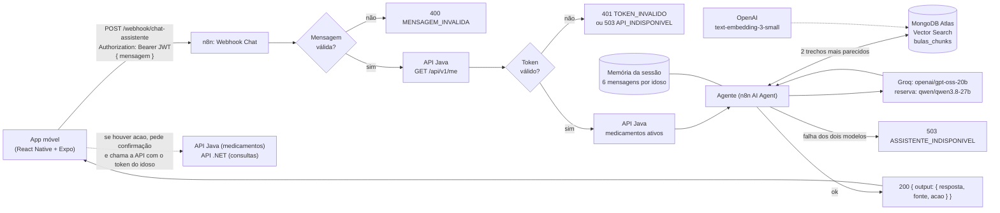

# Remembered: assistente de IA com RAG para idosos

Global Solution 2026/2 (CitizenTech) · Disruptive Architectures: IoT, IoB & Generative IA · FIAP · Turma 2TDSPV

## Integrantes

| RM | Nome |
|---|---|
| 561489 | Ana Flavia Camelo |
| 562745 | Gustavo Kenji Terada |
| 566234 | João Guilherme Carvalho Novaes |
| 561342 | Lucas Figueiredo Vieira |
| 565154 | Pedro Chasci Puga |

## Descrição da funcionalidade

O Remembered é um aplicativo de cuidado com medicamentos para idosos que moram sozinhos ou com pouca supervisão, com acompanhamento à distância pelo cuidador. Este repositório traz a funcionalidade de IA generativa do projeto: um **assistente de conversa com RAG**.

O idoso escreve uma pergunta em linguagem natural ("para que serve este remédio?", "quais são os efeitos colaterais?") e recebe uma resposta em português simples, baseada **somente em trechos de bulas**, com a fonte (medicamento e seção). Ele também pode pedir para cadastrar um medicamento ou uma consulta. Nesse caso o assistente **só propõe** a ação, e o aplicativo pede a confirmação do idoso antes de gravar qualquer coisa.

Problema atendido: idosos com vários remédios têm dificuldade de entender bulas longas e de lembrar do que evitar. O assistente leva a informação confiável até eles sem exigir leitura de bula nem preenchimento de formulários. O projeto se liga aos ODS 3 (saúde e bem-estar), 10 (redução das desigualdades) e 11 (comunidades sustentáveis e inclusivas).

Os outros repositórios do projeto (aplicativo, API Java do idoso e API .NET do cuidador) estão listados em [Repositórios relacionados](#repositórios-relacionados).

## Arquitetura



Fluxo em palavras:

1. O app envia a mensagem no corpo e o JWT do idoso no cabeçalho `Authorization`.
2. O n8n valida a mensagem (1 a 1000 caracteres) e confirma o token na API Java (`GET /api/v1/me`).
3. O n8n busca os medicamentos ativos do idoso (só nome e dosagem), usados como contexto.
4. O agente consulta a base de bulas por busca vetorial (2 trechos) e o modelo redige a resposta usando só esses trechos.
5. A resposta volta em JSON com `resposta`, `fonte` e `acao`. O chat nunca grava dados: a gravação é feita pelo app, depois da confirmação do idoso.

## Modelos e tecnologias, com justificativas

| Peça | Escolha | Por quê |
|---|---|---|
| Abordagem de IA | **RAG básico** (recuperação + geração) | A resposta precisa ser verificável e vir da bula. Um LLM sem RAG responderia de memória e poderia inventar informação sobre remédio, o que é arriscado para idosos. Fine-tuning exigiria muitos dados e custo e não permitiria citar a bula nem atualizá-la com facilidade. Busca por palavras-chave não entende perguntas em linguagem natural. |
| LLM | Groq, `openai/gpt-oss-20b` (temperatura 0,2, até 600 tokens) | Rápido e barato por API, sem infraestrutura própria. Temperatura baixa deixa as respostas mais estáveis. |
| LLM reserva | Groq, `qwen/qwen3.8-27b` | O plano gratuito limita os tokens por minuto de cada modelo. Se o principal falhar, o n8n troca para o reserva, que tem limite próprio. |
| Embeddings | OpenAI `text-embedding-3-small` (1536 dimensões, cosseno) | Mesmo modelo na criação da base e na consulta, como exige a busca vetorial. |
| Base vetorial | MongoDB Atlas Vector Search | Guarda texto, embedding e metadados dos trechos e faz a busca por similaridade. |
| Orquestração | n8n (AI Agent, memória, ferramenta de busca, parser de saída) | Monta o fluxo sem código e deixa a lógica visível. |
| Saída estruturada | Parser com schema JSON (`resposta`, `fonte`, `acao`) | O app precisa de campos previsíveis para mostrar o texto e a confirmação. |
| Memória | Janela de 6 mensagens por idoso | Dá continuidade à conversa sem estourar o limite de tokens. |

## Estrutura do repositório

```
.
├── README.md                      Este arquivo
├── .env.example                   Variáveis de exemplo, sem segredos
├── .gitignore
├── workflows/
│   └── remembered-chat-assistente.json   Workflow do n8n, sem credenciais
└── docs/
    └── (documentação em PDF)      Documento completo do projeto, com testes e limitações
```

## Como executar

### Pré-requisitos

- Conta no **n8n** (Cloud ou instância própria) com o nó de AI Agent disponível.
- Chave da **Groq** (plano gratuito serve).
- Chave da **OpenAI** para embeddings, ou os créditos de gateway do n8n Cloud.
- Cluster do **MongoDB Atlas** com a coleção `bulas_chunks` e o índice vetorial abaixo.
- A **API Java** do projeto no ar, para validar o token (`GET /api/v1/me`) e listar medicamentos.

### Base de bulas

A base é feita de bulas de medicamentos de uso público, divididas em trechos de 2000 caracteres com sobreposição de 200. Cada documento da coleção `bulas_chunks` tem:

| Campo | Conteúdo |
|---|---|
| `text` | Texto do trecho |
| `embedding` | Vetor de 1536 números (`text-embedding-3-small`) |
| `medicamento` | Nome do medicamento |
| `principioAtivo` | Princípio ativo |
| `fonteUrl` | Origem da bula |

Índice de busca vetorial (Atlas Search, tipo *Vector Search*), com o nome `bulas_vector_index`:

```json
{
  "fields": [
    { "type": "vector", "path": "embedding", "numDimensions": 1536, "similarity": "cosine" }
  ]
}
```

A base não tem nenhum dado pessoal.

### Passo a passo

1. **Credenciais no n8n.** Em *Credentials*, crie `Groq account` (chave da Groq), `MongoDB account` (string de conexão do Atlas) e a credencial de embeddings da OpenAI. Os valores de exemplo estão em `.env.example`. Os segredos ficam só no n8n.
2. **Importe o workflow.** Em *Workflows > Import from file*, escolha `workflows/remembered-chat-assistente.json`.
3. **Ligue as credenciais.** Abra os nós `Modelo Groq`, `Modelo Groq reserva (Qwen)`, `buscar_bula` e `Embeddings OpenAI` e selecione as credenciais criadas no passo 1. No nó `buscar_bula`, confira o nome da coleção (`bulas_chunks`) e do índice (`bulas_vector_index`).
4. **Aponte para a sua API Java.** Nos nós `Validar Token (GET me)` e `Buscar Medicamentos Ativos`, troque a URL base pela da sua API (`JAVA_API_BASE_URL`).
5. **Publique.** Ative o workflow. O endereço do webhook será `https://<sua-instancia>.app.n8n.cloud/webhook/chat-assistente` (método POST).
6. **Teste.** Obtenha um token de idoso na API Java (`POST /api/v1/auth/login`) e chame o webhook:

```bash
curl -X POST "$N8N_WEBHOOK_URL" \
  -H "Content-Type: application/json" \
  -H "Authorization: Bearer <JWT_DO_IDOSO>" \
  -d '{ "mensagem": "Para que serve o meu remédio?" }'
```

### Contrato do webhook

| Situação | Código | Corpo |
|---|---|---|
| Sucesso | 200 | `{ "output": { "resposta": "...", "fonte": { "medicamento": "...", "secao": "..." } \| null, "acao": { "tipo": "CRIAR_MEDICAMENTO" \| "CRIAR_CONSULTA", "payload": { ... } } \| null } }` |
| Mensagem vazia ou com mais de 1000 caracteres | 400 | `{ "erro": "MENSAGEM_INVALIDA", "mensagem": "..." }` |
| Token recusado | 401 | `{ "erro": "TOKEN_INVALIDO", "mensagem": "..." }` |
| API Java fora do ar | 503 | `{ "erro": "API_INDISPONIVEL", "mensagem": "..." }` |
| Os dois modelos falharam (por exemplo, limite de tokens) | 503 | `{ "erro": "ASSISTENTE_INDISPONIVEL", "mensagem": "..." }` |

O app deve usar um tempo limite de pelo menos 90 segundos e mostrar um indicador de "digitando", porque a resposta pode demorar quando o fluxo troca para o modelo reserva.

### Como adaptar

- **Trocar o modelo:** altere o nó `Modelo Groq`. Os embeddings devem continuar no modelo usado para criar a base.
- **Mudar o formato da resposta:** edite o schema do nó `Parser de Saida` (`resposta`, `fonte`, `acao`).
- **Ajustar o contexto:** o número de trechos está em `topK` do nó `buscar_bula` e o tamanho da memória em `contextWindowLength` do nó `Memoria da Sessao`.
- **Mudar as regras do assistente:** edite o prompt de sistema do nó `Agente Assistente`.

## Testes e avaliação

Os casos de teste, os critérios, os resultados e a análise das limitações estão na documentação completa do projeto, na pasta [`docs/`](docs/) (seção 5, Testes e validação, e seção 6, Resultados e limitações).

Para repetir um teste sem o chat de teste, chame o webhook com `curl` (exemplo em [Passo a passo](#passo-a-passo)).

## Uso responsável e limitações da IA

- O assistente usa IA generativa, **pode errar**, e **não substitui médico nem farmacêutico**.
- Ele responde só com base nos trechos de bula recuperados. Sem base, diz que não encontrou e encaminha ao médico ou farmacêutico.
- Ele **nunca indica dose, troca, suspensão ou combinação de remédios**. Em sinais de emergência, orienta ligar para o SAMU (192).
- A seção da bula citada é inferida do texto do trecho e pode estar errada, porque não é gravada como metadado.
- A base cobre apenas as bulas carregadas. Fora dela, o assistente não responde sobre o medicamento.
- O chat **não grava nada**: só propõe ações, e o idoso confirma no app.
- Depende de serviços externos (Groq, OpenAI, MongoDB Atlas e a API Java). O plano gratuito da Groq limita cada modelo a 8 mil tokens por minuto, o que causou erros de "assistente indisponível" nos nossos testes. O plano pago resolve isso.

### Segurança e dados pessoais

- Nenhuma credencial está no repositório. Chaves e senhas ficam nas credenciais do n8n e em variáveis de ambiente (`.env` está no `.gitignore`).
- O webhook é público, mas só responde depois de validar o token do idoso na API Java. O histórico da conversa é separado por idoso.
- Só o nome e a dosagem dos medicamentos ativos do próprio idoso vão ao modelo, como contexto. Esses dados passam pela Groq e a pergunta passa pela OpenAI, para gerar o embedding.
- Os testes usaram um usuário de teste com dados fictícios.

## Repositórios relacionados

- Aplicativo móvel (React Native e Expo): https://github.com/FIAP-MOBILE-2026-Fevereiro/RememberED
- Serviço do idoso (Java e Spring Boot): https://github.com/vitalis-sa/gs-remembered-java
- Serviço do cuidador (.NET): https://github.com/vitalis-sa/gs-remembered-dotnet
- Workflows do n8n e documentação da IA (este repositório): https://github.com/vitalis-sa/gs-remembered-iot
